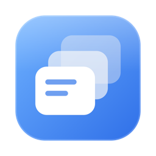

<p align="center"></p>

<h1 align="center">Dropod</h1>

<p align="center">A shelf for everything you're moving.<br>
A free, open-source drag-and-drop shelf for macOS, with screenshots and clipboard history built in.</p>

https://github.com/user-attachments/assets/4b887fa2-f070-4fb4-8845-df6d435965a3

---

While you drag a file, **shake the pointer** and Dropod appears beside it. Drop files, images, links or text on it, switch to any app, and drag them out when you're ready. When you're done, it shrinks into a small capsule out of the way.

Dropod is a native AppKit app with Liquid Glass on macOS 26. It needs no special permissions, never takes focus from the app you're using, and keeps everything on your Mac.

## Features

### A shelf that's there when you need it
- **Shake to open:** shake the pointer while dragging, or press **⇧⌘Space**, and a new tab opens beside the cursor. If you don't drop anything, it goes away again.
- **Drop anything:** files, folders, images from a web page, links, text, and files promised by Mail or Photos.
- **Drag out anywhere:** drag one item or the whole selection into any app. Originals are never moved.
- **Tabs:** one window, with a tab for each pile. You can name, colour and pin tabs. Closed one by mistake? Press **⌘Z**.
- **Pile, list and grid:** a fanned stack of the newest items, a list with sizes, or a grid with AirDrop, Share and ZIP.
- **Quick actions:** AirDrop, Share, Compress to ZIP, Resize and Convert images, and Copy Text from Image (on-device OCR).
- **Quick Look:** press Space, and use the arrow keys to move through items, as in Finder.

### Screenshots, straight to your clipboard
- Every screenshot is **copied to the clipboard** and added to a **Screenshots** tab, so you can paste it straight into a chat or document.
- Screenshots leave the tab after a day by default (you can choose 1 hour to forever). The files themselves are never touched.

### Clipboard history, one shortcut away
- Text you copy is kept as clips in a **Clipboard** tab, for a week, up to 200 clips (both adjustable).
- **⌃⌘V** opens it with search ready. Type, press **↩**, and paste.
- **Peek** shows a long clip in full beside the window, with formatted JSON and code and clickable links.
- Copies from password managers and other apps that mark text as private are skipped.

### Out of the way
- **⌄** collapses Dropod into a small capsule.
- When something arrives, the right chip unfolds for a moment ("Screenshot copied"), then folds into a badge that shows what's new.
- Opens at login, and lives in the menu bar.

## Install

### Download (the usual way)

1. Download **[Dropod.dmg](../../releases/latest/download/Dropod.dmg)** from the latest release and open it.
2. Drag **Dropod** onto the **Applications** shortcut.
3. Open Dropod from Applications. The first time, macOS shows **"Dropod" Not Opened**, because Dropod isn't notarized by Apple (that needs a paid developer account). Click **Done**, not "Move to Trash".
4. Open **System Settings → Privacy & Security**, scroll down to the message about Dropod, and click **Open Anyway**. Confirm with your password or Touch ID.

You only do this once; after that Dropod opens normally.

### Terminal (no warning at all)

Files downloaded from Terminal aren't marked as coming from the internet, so macOS doesn't stop them. This downloads the latest version, installs it and opens it:

```sh
curl -L -o /tmp/Dropod.dmg https://github.com/nurlanjalil/dropod/releases/latest/download/Dropod.dmg
hdiutil attach -nobrowse -quiet /tmp/Dropod.dmg
cp -R /Volumes/Dropod/Dropod.app /Applications/
hdiutil detach -quiet /Volumes/Dropod
open /Applications/Dropod.app
```

Already downloaded it in the browser and saw the warning? This one line clears it for Dropod only:

```sh
xattr -dr com.apple.quarantine /Applications/Dropod.app
```

Requires macOS 14 or later on Apple silicon. Liquid Glass needs macOS 26; earlier versions get a frosted look.

### Permissions
- **None needed for the shelf.** Drag detection, shake and shortcuts work without Accessibility or Input Monitoring access.
- **Screenshots:** if your screenshots are saved in Documents or Desktop, macOS asks once for access to that folder.

## Shortcuts

| Keys | Action |
|:--|:--|
| Shake while dragging | Open a new tab beside the pointer |
| ⇧⌘Space | Show or hide Dropod (while dragging: open a new tab) |
| ⌃⌘V | Open clipboard history with search |
| Space | Quick Look (Peek for text) |
| ↑ ↓ ← → | Move the selection; Quick Look follows |
| ⌘A · ⌘C · ⌫ | Select all · Copy · Remove from Dropod |
| ⌘Z | Undo closing a tab |
| Esc | Collapse Dropod |

Both shortcuts can be changed from the menu bar icon.

## Privacy

Dropod has no network access, no accounts and no analytics. Clips, screenshots and dropped items are stored in `~/Library/Application Support/Dropod/` and never leave your Mac.

## Build from source

You need the Swift toolchain (Xcode or the Command Line Tools). No Xcode project is involved.

```sh
git clone https://github.com/nurlanjalil/dropod.git
cd dropod
./build.sh             # builds build/Dropod.app
./build.sh --install   # builds, installs to /Applications and opens it
./build.sh --dmg       # builds build/Dropod.dmg for a GitHub release
./build.sh --release   # builds build/Dropod-<version>.zip
```

The app is signed ad hoc, so macOS treats each build as a new app and asks again for folder access. See [DEVELOPMENT.md](DEVELOPMENT.md) for the architecture and design decisions.

## License

[MIT](LICENSE)
